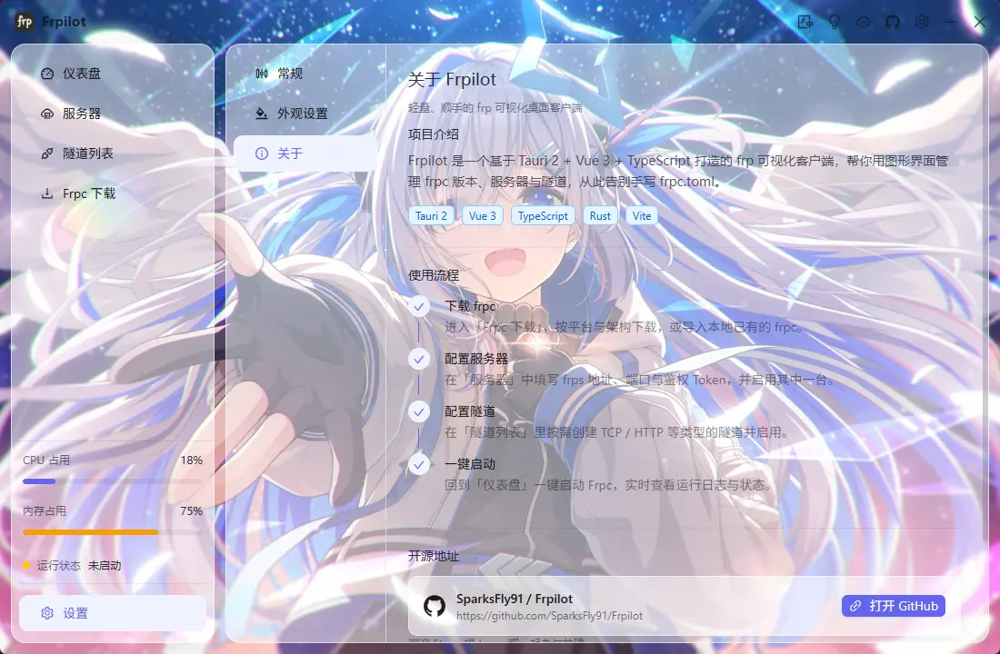

<div align="center">

# FrpcPilot

**frp 可视化桌面客户端 —— 告别手写 `frpc.toml`**

下载 frpc、配置服务器、编排隧道、一键启动并实时查看日志，全部在同一个窗口里完成。

[](https://github.com/SparksFly91/FrpcPilot/releases)
[](./LICENSE)
[](#-下载安装)
[](https://v2.tauri.app/)
[](https://vuejs.org/)
[](https://github.com/SparksFly91/FrpcPilot/pulls)

</div>

---

## 🏷️ 关于「FrpcPilot」这个名字

> **FrpcPilot = Frpc + Pilot**（领航员）

- **Frpc** —— 取自 [frp](https://github.com/fatedier/frp) 的客户端组件 `frpc`，也是本项目服务的核心对象；
- **Pilot** —— 飞行员 / 领航员。frp 本身足够强大，却总离不开手写 `frpc.toml` 与敲命令启动；FrpcPilot 想做你的「frpc 领航员」，把这些繁琐的配置与命令行统统收进图形界面，带你稳稳起飞。

一句话：**让 frpc 起飞，你只管掌舵。** ✈️

---

## 📖 项目简介

**FrpcPilot** 是一个基于 **Tauri 2 + Vue 3 + TypeScript** 的 [frp](https://github.com/fatedier/frp) 图形化客户端。它把原本需要手工编辑 `frpc.toml` 的繁琐流程，变成「点几下就能跑起来」：在线下载 frpc、管理 frps 服务器与隧道、一键启动内网穿透，并实时回显运行日志。

得益于 Tauri 的轻量内核，应用体积小、内存占用低；后端使用 Rust + SQLite 本地持久化，数据完全保存在你自己的电脑上，不经过任何第三方服务。

> 当前版本 **v1.2.1**，已支持 Windows / macOS（Apple Silicon）/ Linux 三平台，并内置应用内自动更新。

---

## 🖼️ 界面预览

| 仪表盘 | 服务器 |
| --- | --- |
|  |  |

| 隧道列表 | Frpc 下载 |
| --- | --- |
|  |  |

| 设置 · 常规 | 设置 · 外观 |
| --- | --- |
|  |  |

<p align="center">
  
</p>

---

## ✨ 功能特性

### 📊 仪表盘
- 一屏总览：服务器数量、隧道数量，以及主机名 / 系统 / 架构 / IP 地址等系统信息
- 选择 frpc 版本后「**一键启动 / 停止**」，运行状态实时联动
- **实时日志**：通过事件流回显 frpc 运行日志（保留最近 500 行，支持一键清空）
- 侧边栏常驻 **CPU / 内存占用** 与运行状态指示（🟢 运行正常 · 🔴 运行异常 · 🟡 未启动）

### 🖥️ 服务器管理
- frps 服务器的新增 / 编辑 / 删除
- 支持服务器地址、端口、鉴权 Token、传输协议、TLS 开关与备注
- 置顶与排序；启用开关（**同一时间仅允许启用一台**服务器）

### 🔀 隧道管理
- 覆盖 **TCP / UDP / HTTP / HTTPS / STCP / XTCP / SUDP / TCPMUX** 等代理类型
- 本地 IP / 端口、远程端口、自定义域名、子域名、URL 前缀
- 高级配置：密钥、加密、压缩、带宽限制、Proxy Protocol、健康检查、负载均衡
- 统一管理启用 / 置顶 / 排序

### 📦 Frpc 下载管理
- 在线拉取 frp 官方版本列表，按平台与架构筛选，支持「所有架构 frpc / frps」开关
- 一键下载并自动解压，实时显示下载 / 解压进度与状态（支持镜像加速）
- 导入本地已有的 `frpc` / `frps`，删除已下载版本、复制下载直链
- **页面级缓存**：应用运行期间仅首次进入时拉取版本列表，避免重复请求触发限流，需要更新时手动点击「刷新」

### 🚀 一键启动与进程管理
- 依据所选版本、已启用的服务器与隧道，自动生成 `frpc.toml` 并拉起独立进程
- 通过 `frpc-log` / `frpc-exit` 事件实时推送日志与进程退出信息
- 应用退出时自动结束 frpc 子进程，避免残留后台进程

### 🗂️ 系统托盘
- 常驻托盘菜单：**显示窗口 / 启动穿透 / 停止穿透 / 退出**
- 左键单击直达主窗口，右键展开菜单；菜单随运行状态与界面语言自动联动
- 「退出」会先停止正在运行的穿透，再退出整个应用

### 🔔 关闭行为
- 关闭窗口时可选「**最小化到系统托盘**」或「**直接退出**」
- 支持「每次询问」与「保持以上选择」两种策略，也可在「设置 - 常规」中随时修改

### 🎨 界面与体验
- **自定义标题栏**：Windows / macOS 双套方案，窗口可拖拽移动；macOS 还原原生红绿灯
- **明暗主题**：一键切换，Tailwind 暗色变体与 Ant Design Vue 暗色算法同步
- **磨砂玻璃视觉**：侧边栏、内容区与卡片统一为圆角 + `backdrop-filter` 半透明面板，透明度可调
- **窗口背景**：内置 9 张背景图，可自由挑选，保持原始比例自适应
- **国际化**：内置简体中文 / English，语言选择持久化并与组件库语言包联动

### 🔄 应用内自动更新
- 启动时静默检查更新，支持手动检查
- 更新弹窗以 **Markdown** 渲染更新说明并展示下载进度
- 支持「忽略该版本」、一键更新，安装完成后自动重启

### ⚙️ 设置中心
- **常规**：关闭行为、应用语言
- **外观**：主题模式、背景图片、磨砂玻璃透明度（卡片 / 弹窗，实时预览）
- **关于**：项目介绍、技术栈、使用流程、开源地址与版本信息

---

## 📥 下载安装

前往 [**Releases**](https://github.com/SparksFly91/FrpcPilot/releases/latest) 下载对应平台的安装包：

| 平台 | 安装包 |
| --- | --- |
| Windows | `.exe`（NSIS 安装程序） |
| macOS（Apple Silicon） | `.dmg` / `.app` |
| Linux | `.deb` / `.AppImage` |

装好后打开应用即可，后续版本会在应用内自动检查并更新。

---

## 🧱 技术栈

| 分类 | 选型 |
| --- | --- |
| 桌面框架 | [Tauri 2](https://v2.tauri.app/)（Rust 后端） |
| 前端框架 | Vue 3（`<script setup>`）+ TypeScript |
| 构建工具 | Vite 8 |
| UI 组件库 | Ant Design Vue 4 + `@ant-design/icons-vue` |
| 样式 | Tailwind CSS 4（原子化）+ SCSS |
| 状态管理 | Pinia |
| 路由 | Vue Router |
| 国际化 | Vue I18n 11 |
| Markdown | `markdown-it`（更新日志渲染） |
| 工具库 | `@vueuse/core` · `dayjs` |
| 后端 | Rust：`sqlx` + SQLite、`reqwest`（下载）、`sysinfo`（系统采集）、`tokio` |
| Tauri 插件 | `updater` / `process` / `dialog` / `opener` / `store` / `prevent-default` |
| 工程化 | `unplugin-auto-import`、`unplugin-vue-components`（按需自动导入）、`tauri-helper`（命令注册） |

---

## 📦 环境要求

- **Node.js** ≥ 20（推荐 20 / 22 LTS）
- **pnpm** ≥ 9（项目使用 pnpm，含 `pnpm-lock.yaml`）
- **Rust** 稳定版工具链（`rustup`，建议 ≥ 1.90）
- **系统依赖**：请参考 [Tauri 前置依赖](https://v2.tauri.app/start/prerequisites/)
  - Windows：WebView2 + MSVC 构建工具
  - macOS：Xcode Command Line Tools
  - Linux：`webkit2gtk`、`libayatana-appindicator`、`librsvg` 等

---

## 🚀 快速开始

```bash
# 1. 克隆仓库
git clone https://github.com/SparksFly91/FrpcPilot.git
cd FrpcPilot

# 2. 安装依赖
pnpm install

# 3. 启动完整桌面应用（推荐，含 Rust 后端）
pnpm tauri dev

# 或者：仅启动前端（浏览器调试，窗口 / 命令类操作会安全空转）
pnpm dev
```

### 常用脚本

| 命令 | 说明 |
| --- | --- |
| `pnpm dev` | 启动 Vite 开发服务器（端口 `1420`） |
| `pnpm tauri dev` | 启动 Tauri 桌面开发环境（自动拉起前端） |
| `pnpm build` | 类型检查（`vue-tsc --noEmit`）+ 构建前端产物到 `dist/` |
| `pnpm preview` | 预览前端构建产物 |
| `pnpm tauri build` | 打包生成各平台安装包 |

> ⚠️ `pnpm dev` 端口固定为 `1420` 且 `strictPort: true`，被占用时会直接报错退出。

---

## 📁 项目结构

```
FrpcPilot/
├── src/                            # 前端（Vue 3 + TypeScript）
│   ├── api/                        # Tauri 命令封装（frp / server / tunnel / system / updater）
│   ├── assets/                     # Tailwind 入口 + 全局样式（磨砂玻璃 / Markdown / 弹窗）与背景图
│   ├── components/                 # 通用组件
│   │   ├── frp / server / tunnel   # 业务卡片与表单弹窗
│   │   ├── CardRadioGroup.vue      # 卡片式单选组（关闭弹窗 / 设置页复用）
│   │   ├── CloseConfirmModal.vue   # 关闭确认弹窗
│   │   ├── UpdateModal.vue         # 更新弹窗（Markdown 更新日志 + 进度）
│   │   ├── MarkdownBlock.vue       # Markdown 渲染
│   │   └── WindowsTitleBar / MacTitleBar / TitleBarActions.vue
│   ├── composables/                # usePlatform · useSystemStats · useTray
│   ├── config/backgrounds.ts       # 内置窗口背景图
│   ├── i18n/                       # 国际化（zh-CN / en-US）
│   ├── layout/                     # 主布局 + 标题栏 + 侧边栏
│   ├── router/router.ts            # 路由表（含 meta.isCache 页面缓存开关）
│   ├── stores/                     # app · frpc · update · window（Pinia）
│   ├── types/                      # 自动生成的类型声明与领域类型
│   ├── utils/                      # window（窗口控制）· markdown（渲染）
│   └── views/                      # 页面：仪表盘 / 服务器 / 隧道 / 下载 / 设置
│       └── setting/                # 常规 · 外观 · 关于
├── src-tauri/                      # 后端（Rust）
│   ├── src/
│   │   ├── commands/               # Tauri 命令（frp / runner / server / system / tunnel）
│   │   ├── services/               # 数据库(SQLite) / frpc.toml 生成 / 进程管理 / 系统采集
│   │   ├── models.rs               # 通用数据模型
│   │   └── lib.rs                  # 应用入口与命令注册
│   ├── capabilities/default.json   # 权限声明（窗口 / updater / process 等）
│   ├── tauri.conf.json             # Tauri 主配置（无边框窗口 1100×720）
│   └── tauri.macos.conf.json       # macOS 平台覆盖配置（透明圆角窗口）
├── docs/
│   ├── CHANGELOG.md                # 版本更新日志（发布流程会读取）
│   └── snipastes/                  # 界面截图
├── .github/workflows/release.yml   # 多平台发布工作流
├── index.html
├── vite.config.ts                  # 别名 / 自动导入 / Tailwind 插件
└── package.json
```

---

## 🛠️ 开发指南

### 别名与自动导入

- `@` 指向 `src/`
- 自动导入已开启，以下内容**无需手动 import**：
  - Vue / Vue Router / Pinia / `@vueuse/core` 的 API（如 `ref`、`computed`、`watch`、`useDark`、`useStorage`）
  - Ant Design Vue 组件（模板中直接写 `<a-button>`、`<a-menu>` 等）与图标
  - 类型声明自动生成在 `src/types/auto-imports.d.ts`、`src/types/components.d.ts`
- `vue-i18n` 的 `useI18n` **未**加入自动导入，需手动 `import { useI18n } from "vue-i18n"`。

### 新增 / 修改文案（i18n）

1. 在 `src/i18n/locales/zh-CN.json` 与 `en-US.json` 中按相同层级添加 key（两份文件需保持一致）。
2. 组件内使用 `const { t } = useI18n()`，模板中写 `{{ t("menu.dashboard") }}`。
3. 新增语言：在 `src/i18n/locales/` 添加 JSON，并在 `src/i18n/index.ts` 的 `messages` 与 `languageOptions` 中注册。

### 新增侧边栏菜单项与页面

1. 在 `src/views/` 新建页面组件。
2. 在 `src/router/router.ts` 的 `Layout` 子路由中注册（路径与菜单 `key` 一致）。
3. 在 `src/layout/aside/Aside.vue` 的 `menuItems` 中追加一项（`key` = 路由路径）。
4. 在语言包中补充对应 `menu.*` 文案。

> 若希望页面在切换路由后保留状态（如避免重复请求），在该路由的 `meta` 中设置 `isCache: true`，并在页面组件上用 `defineOptions({ name })` 声明与路由 `name` 一致的组件名。

### 主题与磨砂玻璃

- 主题状态在 `src/stores/app.ts`（`isDark` / `toggleDark`），由 `useDark` 在 `<html>` 上切换 `.dark` 类名并持久化；Ant Design Vue 主题通过 `a-config-provider` 的 `theme.algorithm` 联动。
- `src/assets/main.css` 中的 `.glass-panel`（面板）与 `.glass-card`（卡片）为通用毛玻璃样式，直接加类名即可（已含暗色适配与透明度变量）。

### 窗口控制与权限

- 前端封装：`src/utils/window.ts`（`minimizeWindow` / `toggleMaximizeWindow` / `closeWindow` / `startDragging` 等），在非 Tauri 环境（浏览器）下自动空转。
- 自定义标题栏依赖无边框窗口（`decorations: false`），拖拽通过 `data-tauri-drag-region` 实现。
- **窗口圆角（8px）**：Windows 11 由系统 DWM 自动裁切；macOS 无边框窗口需在 `tauri.macos.conf.json` 中设 `transparent: true`，并在样式上由 `#app` 裁出圆角。
  - ⚠️ 平台配置按 **JSON Merge Patch** 合并且**数组整体替换**，`tauri.macos.conf.json` 需完整重复 `app.windows` 字段；修改基础窗口参数时记得同步。
- 相关权限在 `src-tauri/capabilities/default.json` 中声明。**新增窗口 / 插件 API 调用时需同步补充对应权限**，否则会报 `not allowed`。

### 发布与自动更新

- 版本号取自 `package.json` 的 `version`（`src-tauri/tauri.conf.json` 引用之）。
- 推送 `v*` tag 会触发 `.github/workflows/release.yml`：构建 **Windows x64 / macOS Apple Silicon / Linux x64** 产物，签名生成更新产物与 `latest.json`，并自动从 `docs/CHANGELOG.md` 提取对应版本说明作为 Release 正文。
- 发布前请在 `docs/CHANGELOG.md` 中补上 `## v<版本号>` 段落。

---

## 🗺️ 路线图

- [x] 系统托盘与关闭到托盘
- [ ] 开机自启
- [ ] 主题跟随系统
- [ ] frpc 配置文件的导入 / 导出与校验
- [ ] frps 服务端信息的集中管理与状态检测
- [ ] 日志持久化与导出
- [ ] 更多语言与更多内置背景

---

## 🤝 参与贡献

欢迎提交 Issue 与 Pull Request！

- 提交前请确保 `pnpm build`（类型检查 + 前端构建）通过。
- 遵循现有代码风格与目录结构；涉及新功能时请同步补充 i18n 中英文文案。
- Bug 反馈建议附上操作系统、应用版本与复现步骤。

如果 FrpcPilot 对你有帮助，欢迎点一个 ⭐ **Star** 支持一下～

---

## 📚 参考链接

- [Tauri 2 文档](https://v2.tauri.app/)
- [Vue 3 文档](https://vuejs.org/)
- [Ant Design Vue 4](https://antdv.com/)
- [Tailwind CSS 4](https://tailwindcss.com/)
- [Vue I18n](https://vue-i18n.intlify.dev/)
- [VueUse](https://vueuse.org/)
- [frp 官方仓库](https://github.com/fatedier/frp)

---

## 📄 License

本项目基于 [Apache License 2.0](./LICENSE) 开源。
