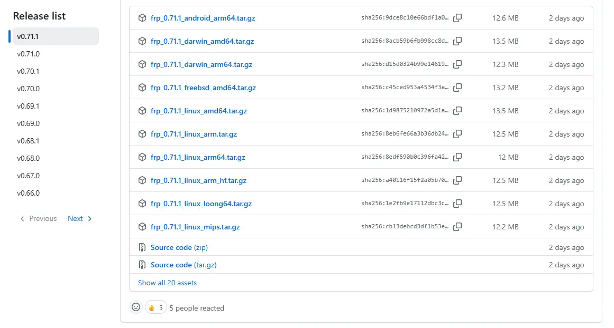
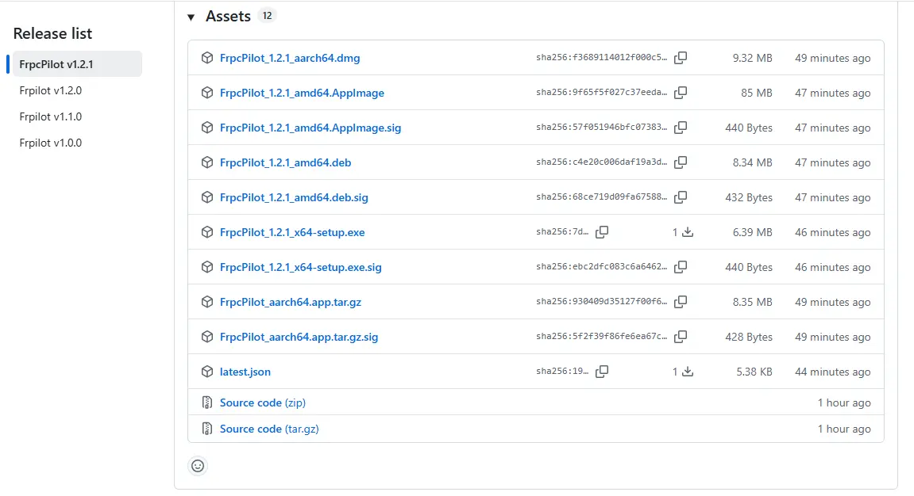

# Frp 内网穿透搭建指南

> 本文带你从 **0 到 1** 完成一次内网穿透：
> 先在公网服务器上搭好 frp 服务端（frps），再用 **[FrpcPilot](https://github.com/SparksFly91/FrpcPilot)** 图形化客户端在本机一键开启穿透，全程无需手写配置文件。
>
> 如果你还不会用命令行操作客户端，可以直接跳到「[三、使用 FrpcPilot 开启本地穿透](#三使用-frpcpilot-开启本地穿透推荐)」。

## 目录

- [一、下载 frp](#一下载-frp)
- [二、公网服务端搭建（frps）](#二公网服务端搭建frps)
- [三、使用 FrpcPilot 开启本地穿透（推荐）](#三使用-frpcpilot-开启本地穿透推荐)
- [四、附：手动配置 frpc 客户端（可选）](#四附手动配置-frpc-客户端可选)
- [五、常见问题排查](#五常见问题排查)

---

## 一、下载 frp

前往官方发布页下载**与服务器系统 / 架构匹配**的版本：

- GitHub 发布页：<https://github.com/fatedier/frp/releases>



同一个压缩包里同时包含**客户端**与**服务端**：

| 文件 | 说明 |
| --- | --- |
| `frps` | 服务端程序（部署在**公网服务器**） |
| `frps.toml` | 服务端配置文件 |
| `frpc` | 客户端程序（运行在**内网机器**） |
| `frpc.toml` | 客户端配置文件 |

> 💡 使用 FrpcPilot 时，**服务端**仍需手动部署（见第二节），**客户端**则完全由 FrpcPilot 代劳 —— 它会自动下载 frpc、生成 `frpc.toml` 并启动进程。

---

## 二、公网服务端搭建（frps）

### 1. 准备工作

- 一台具有**公网 IP** 的服务器：阿里云、腾讯云、百度云、华为云等均可。
- 在云服务商的**安全组 / 防火墙**中放行以下端口：
  - `7000`：frps 与 frpc 的通信端口（对应 `bindPort`）；
  - 你计划映射的**远程端口**（如 `6001`、`6002`…）。
- 将下载好的 frp 压缩包上传到服务器（推荐使用宝塔面板或 `scp`），解压到固定目录，例如 `/www/server/frp`。

### 2. 编写服务端配置 `frps.toml`

在 frps 所在目录创建 `frps.toml`：

```toml
bindPort = 7000
auth.token = "链接凭证，自己设置"   # 客户端需与此处保持一致
```

> - `bindPort`：frps 监听端口，需在安全组放行。
> - `auth.token`：客户端连接令牌，务必记住，FrpcPilot 添加服务器时要填写同一个值。

### 3. 注册 systemd 服务（开机自启）

创建服务单元文件：

```shell
vim /lib/systemd/system/frps.service
```

写入以下内容（**请将 `ExecStart` 中的路径改成你自己的 frps 实际路径**）：

```ini
[Unit]
Description=frps daemon
After=network.target

[Service]
Type=simple
# frps 程序所在位置，根据自己的路径修改
ExecStart=/www/server/frp/frps -c /www/server/frp/frps.toml
Restart=always
RestartSec=1min
ExecStop=/usr/bin/killall frps

[Install]
WantedBy=multi-user.target
```

> ⚠️ 注意：systemd 的配置项**不支持行内注释**，注释请单独占一行，否则 `#` 之后的内容会被当成命令的一部分。

### 4. 加载配置并启动

```shell
# 创建 / 修改 service 文件后，必须先重新加载
systemctl daemon-reload

# 设置开机自启
systemctl enable frps

# 启动服务
systemctl start frps

# 查看运行状态（看到 active (running) 即成功）
systemctl status frps
```

也可以一条命令完成「开机自启 + 立即启动」：

```shell
systemctl enable --now frps
```

### 5. 常用管理命令

| 操作 | 命令 |
| --- | --- |
| 启动 | `systemctl start frps` |
| 停止 | `systemctl stop frps` |
| 重启 | `systemctl restart frps` |
| 查看状态 | `systemctl status frps` |
| 开机自启 / 取消 | `systemctl enable frps` / `systemctl disable frps` |
| 修改配置后重载 | `systemctl daemon-reload && systemctl restart frps` |

### 6. 放行端口（重要）

除云服务商的**安全组**外，若服务器开启了系统防火墙，也需放行端口：

```shell
# firewalld（CentOS / RHEL）
firewall-cmd --permanent --add-port=7000/tcp
firewall-cmd --permanent --add-port=6001/tcp
firewall-cmd --reload
```

```shell
# ufw（Ubuntu / Debian）
ufw allow 7000/tcp
ufw allow 6001/tcp
```

到这里，服务端就搭建完成了。接下来用 **FrpcPilot** 在本机开启穿透。

---

## 三、使用 FrpcPilot 开启本地穿透（推荐）

[FrpcPilot](https://github.com/SparksFly91/FrpcPilot) 是一款 frp 图形化客户端，帮你把「下载 frpc → 写 `frpc.toml` → 敲命令启动」的流程，变成界面上的点几下即可完成。

### 1. 下载并安装 FrpcPilot

前往 [Releases](https://github.com/SparksFly91/FrpcPilot/releases/latest) 下载对应系统的安装包（Windows / macOS / Linux），安装后打开。



### 2. 下载 frpc 客户端


1. 打开侧边栏「**Frpc 下载**」页面；
2. 找到与**本机系统 / 架构**匹配的版本，点击「**下载**」，等待下载并自动解压完成（卡片会显示「已下载」）；
3. 若本机已有 frpc，也可点击「**导入本地**」直接导入。

### 3. 添加服务器（对应 frps）


进入「**服务器**」页面，点击右上角「**新增服务器**」，按服务端配置填写：

| 字段 | 填写内容 | 示例 |
| --- | --- | --- |
| 名称 | 自定义，仅用于展示 | 我的公网服务器 |
| 服务器地址 | frps 所在公网 **IP 或域名** | `frp.example.com` |
| 端口 | frps 的 `bindPort` | `7000` |
| 鉴权 Token | 与 `frps.toml` 中的 `auth.token` **完全一致** | `链接凭证` |
| 传输协议 | 默认 `TCP` 即可 | `TCP` |
| 启用 TLS | 按需，默认关闭 | 关闭 |

保存后，打开该服务器的「**启用**」开关。
> 📌 同一时间**只能启用一台**服务器。

### 4. 添加隧道（要穿透的本地服务）


进入「**隧道列表**」页面，点击右上角「**新增隧道**」，以本地 MySQL 为例：

| 字段 | 填写内容 | 示例 |
| --- | --- | --- |
| 名称 | 自定义隧道名 | `mysql` |
| 代理类型 | 按服务类型选择 | `TCP` |
| 本地 IP | 本地服务地址 | `127.0.0.1` |
| 本地端口 | 本地服务端口 | `3306` |
| 远程端口 | 通过公网访问的端口（需在安全组放行） | `6001` |

保存后打开「**启用**」开关。
> - 可同时启用**多个**隧道（如再加一条 `ssh`：本地 `22` → 远程 `6002`）。
> - `HTTP / HTTPS` 类型支持自定义域名、子域名、URL 前缀；`STCP / XTCP / SUDP` 类型需填写密钥。

### 5. 一键启动


回到「**仪表盘**」：

1. 在「Frpc 版本」下拉框中选择刚下载的版本；
2. 点击「**一键启动**」；
3. 下方「**实时日志**」出现 `login to server success`，即表示已成功连上服务端，隧道开始工作。

> FrpcPilot 会根据「已启用的服务器 + 已启用的隧道」**自动生成 `frpc.toml`** 并拉起独立进程；
> 关闭软件（或点击「停止」）时会自动结束 frpc 进程，不会留下后台残留。

### 6. 验证穿透是否生效

在外网通过 **`公网IP:远程端口`** 访问即可到达本地服务：

```text
mysql  →  frp.example.com:6001   →   127.0.0.1:3306
ssh    →  frp.example.com:6002   →   127.0.0.1:22
```

### 7. 界面字段与 frpc.toml 对照

FrpcPilot 的所有设置最终都会被转换成标准的 frpc 配置，方便你理解与排障：

| FrpcPilot | frpc.toml |
| --- | --- |
| 服务器地址 | `serverAddr` |
| 端口 | `serverPort` |
| 鉴权 Token | `auth.token` |
| 传输协议 | `transport.protocol` |
| 启用 TLS | `transport.tls.enable` |
| 隧道 · 名称 | `proxies.name` |
| 隧道 · 代理类型 | `proxies.type` |
| 隧道 · 本地 IP / 端口 | `proxies.localIP` / `proxies.localPort` |
| 隧道 · 远程端口 | `proxies.remotePort` |
| 隧道 · 自定义域名 / 子域名 / URL 前缀 | `proxies.customDomains` / `proxies.subdomain` / `proxies.locations` |

---

## 四、附：手动配置 frpc 客户端（可选）

如果你不使用 FrpcPilot，也可以手动运行 frpc。

### Windows

`frpc.toml` 示例：

```toml
serverAddr = "frps服务端所在公网ip"
serverPort = 7000          # 服务端占用的端口号

[[proxies]]
name = "mysql"             # 隧道名称
type = "tcp"               # 隧道类型
localIP = "127.0.0.1"      # 本地 ip
localPort = 3306           # 本地端口
remotePort = 6001          # 远程端口

[[proxies]]
name = "Redis"
type = "tcp"
localIP = "127.0.0.1"
localPort = 6379
remotePort = 6002
```

启动客户端：

```shell
frpc.exe -c frpc.toml
```

也可在 `frpc.exe` 所在目录新建 `start.bat`，双击即可启动：

```bat
frpc.exe -c frpc.toml
```

### Linux（CentOS）

在 `/opt/frp` 目录放置 `frpc` 与 `frpc.toml`（linux-amd64 版本），配置示例（穿透本机 SSH）：

```toml
serverAddr = "frps服务端所在公网ip"
serverPort = 7000

[[proxies]]
name = "centos7-ssh"
type = "tcp"
localIP = "127.0.0.1"
localPort = 22
remotePort = 10022
```


注册为 systemd 服务，实现后台常驻与开机自启：

```shell
vim /lib/systemd/system/frpc.service
```

```ini
[Unit]
Description=frpc daemon
After=network.target

[Service]
Type=simple
# frpc 程序所在位置，根据自己的路径修改
ExecStart=/opt/frp/frpc -c /opt/frp/frpc.toml
Restart=always
RestartSec=1min
ExecStop=/usr/bin/killall frpc

[Install]
WantedBy=multi-user.target
```

```shell
systemctl daemon-reload
systemctl enable --now frpc
systemctl status frpc
```


---

## 五、常见问题排查

### 连接成功但隧道启动失败：`start error: port unavailable`

```text
[client/control.go] [mysql] start error: port unavailable
```

含义：已连接到公网 frps，但**远程端口被占用**（示例中映射的是 `6001`，被其他程序占用）。
解决：换一个未被占用的**远程端口**，或在服务端释放该端口。

### 本地服务连接失败：`connect to local service ... refused`

```text
[proxy/proxy.go] [mysql] connect to local service [127.0.0.1:3306] error: ... target machine actively refused it.
```

含义：**本地服务没有启动**（或端口 / IP 写错）。
解决：确认本地服务已在 `localIP:localPort` 上正常运行。

### 查看端口占用 / 终止进程

```shell
# Linux / macOS：查看占用
lsof -i :6001

# 终止进程
kill <pid>
```

```bat
:: Windows：查看占用
netstat -ano | findstr 6001

:: 终止进程
taskkill /PID <pid> /F
```

### 完全连不上服务端

- 检查云服务商**安全组**与系统**防火墙**是否放行 `bindPort`（默认 `7000`）；
- 检查「鉴权 Token」是否与 `frps.toml` 中的 `auth.token` 完全一致；
- 在服务器上确认 frps 正在运行：`systemctl status frps`。
